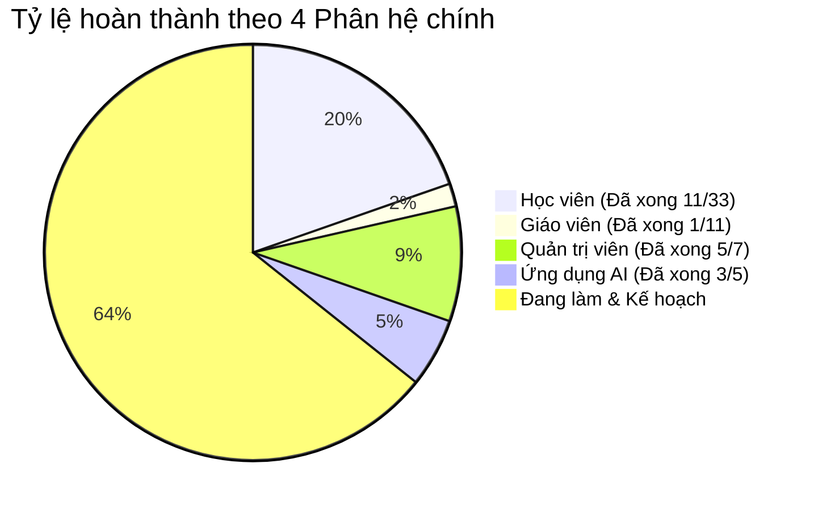
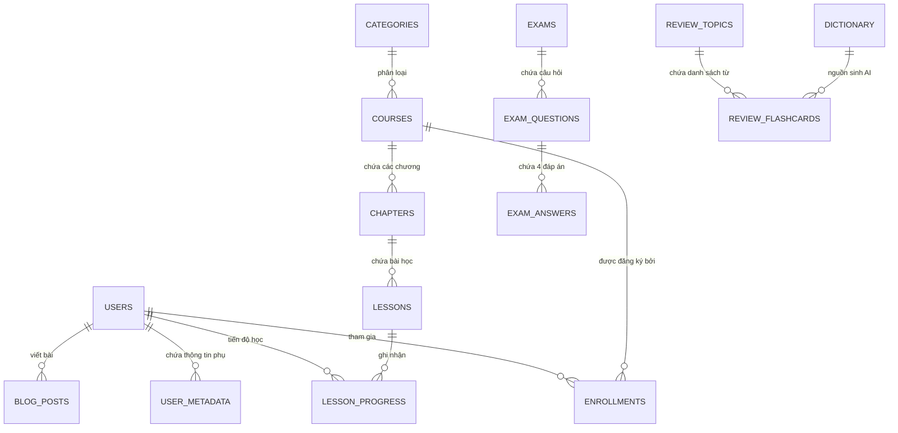

<div align="center">

# 🎓 NIKALEARN — NỀN TẢNG LUYỆN THI TOEIC & E-LEARNING THÔNG MINH TÍCH HỢP AI

[](https://nextjs.org/)
[](https://react.dev/)
[](https://www.typescriptlang.org/)
[](https://tailwindcss.com/)
[](https://supabase.com/)
[](https://ai.google.dev/)
[](https://www.hutech.edu.vn/)

<p align="center">
  <b>Hệ thống Giáo dục Trực tuyến kết hợp Luyện thi Chứng chỉ TOEIC Chuẩn Quốc tế và Lộ trình Kỹ sư Lập trình, ứng dụng Trí tuệ Nhân tạo thế hệ mới (Google Gemini) để cá nhân hóa việc học, sinh flashcard thông minh và tối ưu hóa kết quả thi cử cho sinh viên.</b>
</p>

[📊 Tổng quan Tiến độ](#-tổng-quan-tiến-độ-chức-năng) •
[🎓 Phân hệ Học viên](#1--phân-hệ-học-viên-student) •
[👨‍🏫 Phân hệ Giáo viên](#2--phân-hệ-giáo-viên--trợ-giảng-teacher--ta) •
[⚙️ Phân hệ Admin](#3--phân-hệ-quản-trị-viên-admin) •
[🤖 Phân hệ AI](#4--phân-hệ-ứng-dụng-ai-đột-phá-ai-ecosystem) •
[🚀 Cài đặt](#-hướng-dẫn-cài-đặt--triển-khai-local) •
[🔑 Tài khoản Demo](#-tài-khoản-thử-nghiệm-demo)

---

</div>

## 📌 Thông tin Đề tài & Tác giả

> **ĐỒ ÁN CHUYÊN NGÀNH CÔNG NGHỆ THÔNG TIN**  
> **Trường:** Đại học Công Nghệ TP. Hồ Chí Minh (HUTECH)  
> **Khoa:** Công Nghệ Thông Tin  
> 
> - **Sinh viên thực hiện:** **Trần Phú Quốc**
> - **Lớp:** **26DTHA6**
> - **Giảng viên hướng dẫn:** **Thầy Dương Quốc Nam**
> - **Tên dự án:** **NikaLearn — Nền tảng Luyện thi TOEIC & E-learning Thông minh**
> - **Thời gian thực hiện:** 2026

---

## 📖 Giới thiệu Dự án

**NikaLearn** là nền tảng học tập trực tuyến thông minh giải quyết trọn vẹn 2 nhu cầu cấp thiết hàng đầu của sinh viên Đại học:
1. **Luyện thi chứng chỉ tiếng Anh TOEIC chuẩn ETS:** Chuẩn bị đầu ra tốt nghiệp và tuyển dụng (mục tiêu 500 – 900+ điểm) với đầy đủ 7 Part Listening & Reading, bài luyện nghe chất lượng cao và flashcard từ vựng tương tác.
2. **Nâng cao năng lực chuyên môn Công nghệ thông tin:** Lộ trình bài bản (Frontend, Backend, Fullstack, Mobile), học qua video chất lượng cao kèm **Code Playground trực tuyến** thực thi mã nguồn ngay trên trình duyệt, hệ thống hỏi đáp Q&A và cấp chứng chỉ số.
3. **Ứng dụng Trí tuệ Nhân tạo chuyên sâu (Google Gemini):**
   - Gia sư AI hỗ trợ học tập 24/7 với kỹ thuật **RAG (Retrieval-Augmented Generation)**.
   - Tự động sinh Flashcard bài tập từ vựng từ kho **Database Supabase 28.000 từ** chỉ trong 50ms.
   - Mô phỏng phỏng vấn kỹ thuật và tiếng Anh (**Mock Interview**) tích hợp phòng họp trực tuyến Jitsi Meet.

---

## 📊 Tổng quan Tiến độ Chức năng

Hệ thống được thiết kế và theo dõi theo **4 Phân hệ chính** với tổng cộng **56 chức năng chuẩn hóa** (tham chiếu chi tiết tại [ROADMAP.md](file:///d:/Hutech/elearning-system%20(work)/ROADMAP.md)):



| Phân hệ | Tổng số chức năng | 🟢 Hoàn thành | 🟡 Đang làm | ⚪ Kế hoạch | Tiến độ |
| :--- | :---: | :---: | :---: | :---: | :---: |
| **🎓 1. PHÂN HỆ HỌC VIÊN (Student)** | 33 | 11 | 4 | 18 | **42%** |
| **👨‍🏫 2. PHÂN HỆ GIÁO VIÊN (Teacher / TA)** | 11 | 1 | 2 | 8 | **18%** |
| **⚙️ 3. PHÂN HỆ QUẢN TRỊ VIÊN (Admin)** | 7 | 5 | 1 | 1 | **71%** |
| **🤖 4. PHÂN HỆ ỨNG DỤNG AI (AI Engine)** | 5 | 3 | 1 | 1 | **60%** |
| **🔥 TỔNG TOÀN DỰ ÁN** | **56** | **20** | **8** | **28** | **~45%** |

---

## ✨ Chi tiết Các Phân hệ Chức năng

---

### 1. 🎓 PHÂN HỆ HỌC VIÊN (STUDENT)

#### 1.1. Module Tài khoản & Bảo mật (16 tính năng)

| STT | Chức năng | Trạng thái | Vị trí mã nguồn / Ghi chú |
| :---: | :--- | :---: | :--- |
| **01** | **Đăng ký tài khoản (Email / Số điện thoại)** | 🟢 Hoàn thành (100%) | Đã gộp 1 ô nhập duy nhất, tự nhận diện Email hoặc SĐT; tự động cấp 16 mã Recovery Keys (`/api/auth/register`, `AuthModal.tsx`). |
| **02** | **Đăng ký / Đăng nhập Google OAuth2** | 🟢 Hoàn thành (100%) | Google OAuth tích hợp Supabase Auth bảo mật cao. |
| **03** | **Xác thực tài khoản (OTP Email / SMS)** | 🟢 Hoàn thành (100%) | Gửi OTP 6 số qua Gmail SMTP hoặc Twilio SMS; hỗ trợ mã dev popup (`/api/auth/verify-account`). |
| **04** | **Đăng nhập hệ thống** | 🟢 Hoàn thành (100%) | Hỗ trợ Email / SĐT / Username + Mật khẩu, Remember Me 30 ngày, cookie HttpOnly JWT (`/api/auth/login`). |
| **05** | **Đăng xuất hệ thống** | 🟢 Hoàn thành (100%) | Xóa cookie `auth_token`, dọn sạch AuthContext (`/api/auth/logout`). |
| **06** | **Quên mật khẩu & Reset mật khẩu** | 🟢 Hoàn thành (100%) | Đặt lại mật khẩu bằng mã OTP Email/SMS hoặc 16 mã Recovery Keys (`/api/auth/forgot-password/*`). |
| **07** | **Đổi mật khẩu (Buộc đăng nhập)** | 🟢 Hoàn thành (100%) | Xác thực bcrypt mật khẩu cũ trước khi lưu mật khẩu mới (`/api/users/password`, `/settings`). |
| **08** | **Cập nhật hồ sơ cá nhân** | 🟢 Hoàn thành (100%) | Cập nhật Họ tên, Trường ĐH HUTECH (`student_university`), Chuyên ngành (`student_major`) tại `/settings`. |
| **09** | **Cập nhật hình ảnh đại diện (Avatar)** | 🟢 Hoàn thành (100%) | Tải ảnh lên Cloudinary CDN qua `/api/upload/avatar`, hiển thị tức thì trên Header & Menu. |
| **10** | **Thiết lập mục tiêu điểm & Deadline** | 🟢 Hoàn thành (100%) | Chọn mốc điểm TOEIC (500/650/785/900+) và ngày thi dự kiến tại `/settings`. |
| **11** | **Giao diện chuẩn Responsive Mobile** | 🟢 Hoàn thành (100%) | Tối ưu màn hình nhỏ, thanh điều hướng đáy (Bottom Nav Bar) và khay kéo vuốt mở rộng (Drawer). |
| **12** | **Xem lịch sử thi & điểm thi** | ⚪ Kế hoạch (0%) | Xem lại danh sách đề thi đã làm và điểm số chi tiết (`/profile/exam-history`). |
| **13** | **Quản lý đa thiết bị (User Sessions)** | ⚪ Kế hoạch (0%) | Theo dõi IP, Thiết bị, Trình duyệt; hỗ trợ đăng xuất từ xa tại `/settings`. |
| **14** | **Bảo mật 2FA (Authenticator & Email)** | ⚪ Đang làm (10%) | Quét mã QR TOTP cho Google Authenticator / Microsoft Authenticator hoặc mã gửi qua Email. |
| **15** | **Audit Log (Nhật ký hành động)** | ⚪ Kế hoạch (0%) | Ghi nhận thời gian, địa chỉ IP và hành vi nhạy cảm của người dùng để bảo đảm an toàn dữ liệu. |
| **16** | **Gửi thông báo (Điểm thi & Nhắc học)** | 🟡 Một phần (20%) | Đã có cấu hình notification preferences trong settings; chuẩn bị kết nối luồng push thông báo. |

#### 1.2. Module Học và Luyện tập TOEIC
- **Từ vựng & Ngữ pháp theo chủ đề:**
  - Học từ vựng theo các nhóm chủ đề thực tế: Kinh doanh (Business), Du lịch (Travel), Văn phòng (Office), Mua sắm (Shopping)...
  - **Flashcard tương tác 2 mặt:** Lật thẻ xem nghĩa, phiên âm quốc tế IPA, audio phát âm mẫu và câu ví dụ trong ngữ cảnh.
  - **Gamification Mini-quiz:** Trắc nghiệm 10 câu tính điểm thưởng và chuỗi làm đúng liên tục (Combo).
  - **Thuật toán Lặp lại Ngắt quãng (Spaced Repetition - SRS):** AI tự động lập lịch nhắc ôn tập từ vựng hay quên theo chu kỳ tối ưu trí nhớ.
- **Luyện kỹ thuật Shadowing (Shadowing Practice):**
  - Luyện nghe và nhại giọng theo các đoạn thoại Part 3 & Part 4 để nâng cao ngữ điệu và phản xạ nghe hiểu.
- **Luyện nghe (Listening - Parts 1, 2, 3, 4):**
  - **Part 1 (Photographs):** Xem hình ảnh, nghe 4 đáp án A-B-C-D chọn mô tả chính xác.
  - **Part 2 (Question - Response):** Nghe câu hỏi ngắn và 3 câu đáp lại.
  - **Part 3 (Conversations) & Part 4 (Talks):** Nghe đoạn hội thoại/độc thoại dài, trả lời nhóm 3 câu hỏi liên quan.
  - **Trình phát Audio chuyên dụng:** Điều chỉnh tốc độ (`0.8x`, `1.0x`, `1.2x`), tua lùi 5s - 10s.
  - **Transcript thông minh:** Tự động ẩn trong lúc làm bài, mở sau khi nộp bài để xem lại; tô sáng từ vựng nghe sai.
- **Luyện đọc (Reading - Parts 5, 6, 7):**
  - **Part 5 (Incomplete Sentences):** Điền từ ngữ pháp & từ vựng vào chỗ trống.
  - **Part 6 (Text Completion):** Điền từ/câu vào đoạn văn hoàn chỉnh.
  - **Part 7 (Reading Comprehension):** Đọc hiểu văn bản đơn, đoạn đôi (Double), đoạn ba (Triple).
  - Bộ đếm giờ riêng cho từng Part, chặn thao tác Copy/Paste trong luồng thi thử.

#### 1.3. Module Thi thử TOEIC Full Test
- **Đề thi chuẩn ETS:** Full 200 câu trong 120 phút liên tục (45 phút Listening + 75 phút Reading).
- **Chế độ Proctor nhẹ:** Chế độ toàn màn hình (Full-screen), phát hiện và cảnh báo khi thí sinh rời tab làm bài.
- **Chấm điểm tức thì:** Ước lượng thang điểm Listening (5 - 495), Reading (5 - 495) và Tổng điểm (10 - 990).
- **Màn hình Review chi tiết:** Lời giải cặn kẽ từng câu, xem transcript audio, thống kê câu dễ/khó/bẫy.

#### 1.4. Module Kế hoạch học & Nhắc việc (Plan & Reminder)
- **Lịch học tuần:** Thiết lập mục tiêu bài học/ngày theo thời gian biểu cá nhân.
- **Đồng bộ Lịch:** Xuất và đồng bộ lịch học vào Google Calendar và Apple Calendar (`.ics`).
- **Hệ thống nhắc nhở:** Gửi thông báo qua Push Notification / Email / SMS cảnh báo khi lệch kế hoạch.

#### 1.5. Module Dashboard & Phân tích Tiến độ
- **Heatmap học tập (GitHub Style):** Thể hiện tần suất và thời gian học tập mỗi ngày trong năm.
- **Phân tích kỹ năng:** Tỉ lệ đúng theo từng Part (1 đến 7) và theo chủ đề ngữ pháp/từ vựng.
- **Đường cong tiến bộ:** Biểu đồ điểm số dự đoán theo thời gian và xác suất đạt mục tiêu vào ngày thi.
- **Next Best Action:** AI phân tích và đưa ra 1 hành động tốt nhất nên làm tiếp theo.

#### 1.6. Module Cộng đồng & Thử thách (Community)
- **Bảng xếp hạng (Leaderboard):** Xếp hạng học viên theo tuần/tháng lọc theo Trường (HUTECH), Khoa hoặc Lớp.
- **Thử thách tuần (Streak Challenge):** Duy trì chuỗi ngày học liên tục để nhận huy hiệu vinh danh.
- **Thảo luận & Báo cáo:** Diễn đàn trao đổi mẹo làm bài dưới từng câu hỏi; nút báo cáo câu hỏi có vấn đề.

#### 1.7. Module Khóa học Lập trình E-Learning (Bổ trợ Chuyên ngành)
- **Khóa học & Lộ trình:** Lộ trình bài bản (Frontend, Backend, Fullstack, Mobile, DevOps).
- **Học tương tác:** Video bài giảng chất lượng cao, bài đọc Markdown chuẩn GFM và highlight code PrismJS.
- **Code Playground trực tiếp:** Trình biên dịch/thực thi mã HTML, CSS, JavaScript ngay trong bài học.
- **Cấp Chứng chỉ Số (Certificate):** Tự động phát hành chứng chỉ hoàn thành khóa học kèm hiệu ứng pháo hoa Confetti.

---

### 2. 👨‍🏫 PHÂN HỆ GIÁO VIÊN / TRỢ GIẢNG (TEACHER / TA)

#### 2.1. Module Lớp học & Theo dõi Sinh viên
- **Quản lý lớp học (`/teacher/classes`):** Tạo lớp/nhóm học phần, cấp link hoặc mã code mời sinh viên tham gia.
- **Giao lộ trình & Đề thi:** Gán đề thi hoặc bài luyện bắt buộc cho cả lớp kèm hạn chót nộp bài (Deadline).
- **Dashboard lớp học:** Xem tổng quan tiến độ làm bài, phổ điểm lớp, tỷ lệ hoàn thành, danh sách sinh viên chưa nộp.

#### 2.2. Module Góp ý & Đánh giá Bài thi
- **Xem chi tiết bài làm:** Truy cập chi tiết từng câu trả lời của sinh viên trong bài thi.
- **Bình luận & Feedback:** Viết nhận xét, lời khuyên trực tiếp trên từng câu hỏi để sinh viên khắc phục lỗi sai.

#### 2.3. Module Soạn & Quản lý Đề thi (Exam Authoring)
- **Soạn thảo đề Part 1 - 7:** Tạo đề thi mới, phân loại câu hỏi theo từng Part TOEIC.
- **Gắn thẻ phân loại (Tagging):** Gắn nhãn điểm ngữ pháp, chủ đề từ vựng, mức độ câu hỏi (Dễ / Trung bình / Bẫy).
- **Upload tư liệu đa phương tiện:** Upload file Audio nghe, ảnh minh họa Part 1, định mốc thời gian (timestamp) đồng bộ với âm thanh.
- **Soạn lời giải chuẩn hóa:** Viết lời giải thích chi tiết đáp án và transcript chuẩn.

#### 2.4. Module Chất lượng & Cân bằng Độ khó
- **Thống kê tỷ lệ chọn:** Phân tích tỷ lệ sinh viên làm đúng từng câu để phát hiện đề quá khó hoặc đề bị lỗi.
- **Kiểm soát bản quyền:** Công cụ rà soát chống trùng lặp câu hỏi và kiểm tra bản quyền tư liệu âm thanh/hình ảnh.

---

### 3. ⚙️ PHÂN HỆ QUẢN TRỊ VIÊN (ADMIN)

#### 3.1. Quản lý Người dùng Hệ thống (`/admin/users`)
- [x] **Xem danh sách tài khoản:** Tra cứu người dùng theo email, tên đăng nhập, trạng thái kích hoạt.
- [x] **Phân quyền vai trò (Role-Based Access - RBAC):** Phân chia 3 quyền: Học viên (`STUDENT`), Giảng viên (`TEACHER`), Quản trị (`ADMIN`). Cấp tài khoản quản trị trực tiếp cho admin (`admin@nikalearn.edu.vn`).
- [ ] **Quản trị trạng thái:** Khóa/Mở khóa tài khoản, kích hoạt thủ công, xem lịch sử đăng nhập.

#### 3.2. Quản lý Ngân hàng Đề thi (`/admin/exams`)
- [x] **Danh sách đề thi:** Quản lý kho đề thi TOEIC L&R, hiển thị số câu hỏi, thời gian làm bài, điểm qua môn.
- [x] **Duyệt & Xuất bản đề:** Chuyển trạng thái Nháp (Draft) sang Xuất bản (Published) để hiển thị ra trang học viên.
- [ ] **Phân loại đề:** Phân chia danh mục đề thi thử (Practice) và đề thi chính thức có giám sát (Graded).

#### 3.3. Quản lý Nội dung Học tập & Flashcard TOEIC AI (`/admin/review`)
- [x] **Kho Từ vựng & Flashcard ôn tập AI:**
  - Kết nối trực tiếp vào bảng `dictionary` trên Supabase (~27.986 từ vựng đầy đủ IPA, nghĩa tiếng Việt, Part of Speech).
  - Tích hợp nút **"Sinh AI từ Database"**: Tự động truy vấn từ vựng theo chủ đề (Airport, Business, Office, Travel, House...), gửi danh sách từ thật từ DB vào Gemini để AI chọn lọc chuẩn trình độ TOEIC (Beginner, Intermediate, Advanced).
  - Tự động sinh ví dụ ngữ cảnh chuẩn bài thi TOEIC (`example_en`), bài tập điền từ (`fill_blank`, `fill_answer`), và mô tả hình ảnh (`image_prompt`).
  - Giao diện Admin chi tiết ([`/admin/review/[id]`](file:///d:/Hutech/elearning-system%20(work)/src/app/admin/review/[id]/page.tsx)): Xem thẻ lật 2 mặt tương tác, nghe phát âm trực tiếp, duyệt hoặc xuất bản (Publish/Draft).
  - Tối ưu ghi hàng loạt (Batch Insert) vào bảng `review_flashcards` trong **50ms**.
- [ ] **Bài viết & Tài liệu:** Kiểm duyệt bài viết blog, quản lý chuyên mục học thuật.

#### 3.4. Báo cáo & Dashboard Quản trị (`/admin`)
- [x] **Dashboard Neobrutalism:** Thiết kế toàn bộ dashboard admin theo phong cách Neobrutalism (TID Forest Moss `#1A2616`, vàng `#FFD23F`, viền đen đậm nét).
- [ ] **Tỷ lệ đạt mục tiêu:** Thống kê tỷ lệ sinh viên đạt mốc điểm đầu ra cam kết (500, 650, 785, 900+).
- [ ] **Dữ liệu phân tích AI:** Tổng hợp các dạng câu hỏi và chủ đề sinh viên toàn trường hay làm sai nhất.

---

### 4. 🤖 PHÂN HỆ ỨNG DỤNG AI ĐỘT PHÁ (AI ECOSYSTEM)

#### 4.1. Hệ thống AI Gateway & Đa mô hình Thông minh (`src/lib/ai-gemini.ts`)
- [x] **Ưu tiên Model `gemini-3.1-flash-lite` (Vị trí #1):**
  - Hạn mức cao: **500 request/ngày** và **15 request/phút** trên Free Tier.
  - Tốc độ phản hồi cực nhanh ~1.5s, không bị nghẽn tải.
- [x] **Tự động dò tìm Model khả dụng thời gian thực (`ModelService.ListModels`):**
  - Quét 41 models trên tài khoản Google của người dùng.
  - Tự động lọc sạch các model cũ/bị hạn chế (`gemini-2.5-flash`, `2.0-flash`, `1.5-flash`).
  - Hàng đợi dự phòng linh hoạt: `gemini-3.1-flash-lite` ➔ `gemini-3.5-flash-lite` ➔ `gemini-flash-lite-latest` ➔ `gemini-3.8-flash` ➔ `gemini-flash-latest` ➔ `gemini-3.8-pro`.
- [x] **Xoay vòng đa API Key (Key Rotation) & Khắc phục High Demand:**
  - Tự động nhận diện nhiều key phân tách bằng dấu phẩy trong `.env.local`.
  - Tự động chuyển key / chuyển model khi gặp lỗi quá tải `high demand` với cơ chế backoff.

#### 4.2. Các Ứng dụng AI Trọng tâm trong Hệ thống
- [x] **Gia sư AI TOEIC (AI Tutor & RAG Engine - `/ai-tutor`):**
  - Giải đáp thắc mắc ngữ pháp, phương pháp làm bài theo từng Part 1–7.
  - Ứng dụng kỹ thuật RAG (Retrieval-Augmented Generation) kết hợp ngữ cảnh đề thi và từ điển, đảm bảo câu trả lời chuẩn xác và hạn chế tối đa ảo giác (hallucination).
- [x] **AI Sinh Flashcard Tự động từ Database (`/admin/review`):**
  - Kết nối trực tiếp vào bảng `dictionary` trên Supabase (~28.000 từ vựng).
  - Tự động chọn lọc từ vựng theo chủ đề và trình độ TOEIC, sinh ví dụ ngữ cảnh chuẩn đề thi (`example_en`), bài tập điền từ (`fill_blank`, `fill_answer`) và prompt hình ảnh (`image_prompt`).
  - Tối ưu ghi hàng loạt (Batch Insert) vào bảng `review_flashcards` chỉ trong 50ms.


---

## 🛠️ Công nghệ sử dụng

| Tầng kiến trúc | Công nghệ / Thư viện | Vai trò |
| :--- | :--- | :--- |
| **Frontend Framework** | **Next.js 15.5.4 (App Router)** | Kiến trúc SSR/SSG/ISR hiện đại với Turbopack bundler |
| **Giao diện & UI** | **React 19.1.0, Tailwind CSS v4** | Xây dựng component hiện đại, CSS utility tối ưu |
| **Hiệu ứng & Hoạt cảnh** | **Framer Motion, Canvas-confetti** | Hoạt họa mượt mà, chuyển trang và chúc mừng hoàn thành |
| **Icons & Trực quan** | **Lucide React, Recharts, ReactFlow** | Bộ icon đồng bộ, vẽ biểu đồ thống kê và sơ đồ lộ trình |
| **Soạn thảo & Hiển thị** | **TipTap Editor, React Markdown, PrismJS** | Soạn thảo rich-text, render markdown chuẩn GFM và highlight code |
| **Backend & API** | **Next.js Route Handlers, Node.js** | Xử lý nghiệp vụ phía máy chủ, bảo mật logic hệ thống |
| **Cơ sở dữ liệu** | **Supabase (PostgreSQL)** | CSDL quan hệ mạnh mẽ, hỗ trợ UUID, RLS, Foreign Keys, Indexing |
| **Lưu trữ tệp & Media** | **Supabase Storage & Cloudinary CDN** | Lưu trữ audio đề thi TOEIC và tối ưu hóa hình ảnh đại diện |
| **Trí tuệ Nhân tạo** | **Google Gemini AI SDK** | Mô hình ngôn ngữ lớn xử lý RAG, giải đáp học tập, sinh Flashcard từ vựng |
| **Video Conference** | **Jitsi Meet API** | Nền tảng hội nghị truyền hình WebRTC cho phòng Mock Interview |
| **Giao tiếp & OTP** | **Nodemailer (Gmail SMTP) & Twilio SMS** | Gửi email thông báo, xác thực tài khoản và khôi phục mật khẩu |
| **Xác thực & Bảo mật** | **Jose, JsonWebToken, BcryptJS** | Quản lý JWT Token, mã hóa mật khẩu và chống tấn công bảo mật |

---

## 📊 Kiến trúc Hệ thống & Cơ sở dữ liệu

### 1. Sơ đồ Quan hệ Thực thể Cốt lõi (ERD)



### 2. Các bảng cơ sở dữ liệu chính trên Supabase

1. **`users`**: Quản lý thông tin tài khoản, mật khẩu băm, quyền hạn (`STUDENT`, `TEACHER`, `ADMIN`), trạng thái kích hoạt và streak học tập.
2. **`user_metadata`**: Lưu trữ các thông tin mở rộng của sinh viên: Trường ĐH (`student_university`), chuyên ngành (`student_major`), điểm mục tiêu TOEIC (`student_target_score`), ngày thi (`student_target_deadline`).
3. **`courses`, `chapters`, `lessons`**: Lưu trữ cấu trúc khóa học, cây chương mục, video URL, thời lượng bài giảng, trạng thái preview và nội dung bài học.
4. **`enrollments`, `lesson_progress`**: Lưu trữ lịch sử ghi danh, tỷ lệ % hoàn thành khóa học, mốc thời gian xem video cuối cùng.
5. **`exams`, `exam_questions`, `exam_answers`**: Ngân hàng đề thi TOEIC, cấu trúc câu hỏi theo Part, đáp án trắc nghiệm, cờ đáp án đúng và lời giải chi tiết.
6. **`review_topics`, `review_flashcards`**: Quản lý các chủ đề ôn tập từ vựng TOEIC và danh sách flashcard (từ, IPA, nghĩa, ví dụ, bài tập điền từ).
7. **`dictionary`**: Kho từ điển tiếng Anh chuyên sâu (~28.000 bản ghi) phục vụ việc truy vấn và cung cấp dữ liệu cho AI sinh bài tập.
8. **`interview_questions`, `interview_rooms`**: Kho câu hỏi phỏng vấn tuyển dụng IT và cấu hình phòng phỏng vấn trực tuyến.
9. **`blog_posts`, `blog_categories`, `blog_tags`**: Hệ thống bài viết học thuật và chuyên mục bài viết.

---

## 📦 Cấu trúc Thư mục Dự án

```
elearning-system/
├── database/                     # Các file script khởi tạo CSDL PostgreSQL
│   ├── migration.sql             # Migration toàn bộ bảng cốt lõi hệ thống
│   ├── exams-schema.sql          # Schema ngân hàng đề thi TOEIC
│   ├── review-schema.sql         # Schema hệ thống flashcard ôn tập AI
│   └── interview-schema.sql      # Schema phỏng vấn Mock Interview
├── public/                       # Tài nguyên tĩnh (ảnh, logo, SVG, audio)
├── scripts/                      # Các tiện ích quản trị & kiểm tra database
│   ├── inspect-supabase.js       # Kiểm tra kết nối và bảng trên Supabase
│   └── migrate-supabase.js       # Script thực thi migration tự động
├── src/
│   ├── app/                      # Next.js App Router (Giao diện & API Routes)
│   │   ├── (main)/               # Layout chính cho học viên
│   │   ├── admin/                # Giao diện Quản trị viên (Neobrutalism Design)
│   │   │   ├── exams/            # Quản lý đề thi TOEIC
│   │   │   ├── review/           # Quản lý Flashcard ôn tập & Sinh AI
│   │   │   ├── interview/        # Quản lý câu hỏi phỏng vấn
│   │   │   ├── lessons/          # Quản lý bài học & lộ trình
│   │   │   └── users/            # Quản lý tài khoản & phân quyền
│   │   ├── ai-tutor/             # Giao diện Gia sư AI TOEIC
│   │   ├── api/                  # API Handlers (RESTful Backend)
│   │   │   ├── admin/            # API nghiệp vụ quản trị
│   │   │   ├── ai/               # API Gemini (chat, flashcard)
│   │   │   ├── auth/             # API đăng ký, đăng nhập, OTP, reset pass
│   │   │   ├── exams/            # API phục vụ thi trắc nghiệm TOEIC
│   │   │   ├── courses/          # API khóa học & bài học
│   │   │   └── review-topics/    # API dữ liệu flashcard ôn tập
│   │   ├── articles/             # Trang blog & bài viết cộng đồng
│   │   ├── courses/              # Chi tiết khóa học & danh sách bài học
│   │   ├── exams/                # Giao diện làm bài thi thử TOEIC
│   │   ├── interview/            # Giao diện phỏng vấn & phòng họp trực tuyến
│   │   ├── learn/                # Màn hình học tương tác (Video + Code Editor)
│   │   ├── qa/                   # Diễn đàn Hỏi - Đáp
│   │   ├── review/               # Màn hình lật thẻ Flashcard ôn tập
│   │   ├── roadmap/              # Cây lộ trình học lập trình trực quan
│   │   ├── settings/             # Cài đặt tài khoản & mục tiêu điểm thi
│   │   └── layout.tsx            # Root layout hệ thống
│   ├── components/               # Các UI Components tái sử dụng
│   │   ├── Home/                 # Banner, HeroSection, CoursesSection
│   │   ├── interview/            # Component phòng họp Jitsi Meet
│   │   ├── CodePlayground.tsx    # Trình thực thi code HTML/CSS/JS tại chỗ
│   │   ├── VideoPlayer.tsx       # Video player lưu tiến độ học tập
│   │   ├── Header.tsx            # Header điều hướng & Avatar người dùng
│   │   └── Menu.tsx              # Sidebar menu & Bottom navigation mobile
│   ├── contexts/                 # React Contexts (AuthContext, ToastContext...)
│   └── lib/                      # Thư viện dùng chung & cấu hình dịch vụ
│       ├── ai-gemini.ts          # Core Gemini Gateway, Key Rotation & Fallback
│       ├── ai-toeic-rag.ts       # RAG context builder cho TOEIC AI Tutor
│       ├── cloudinary.ts         # Tiện ích upload ảnh lên Cloudinary CDN
│       ├── db.ts                 # Trình kết nối & truy vấn Supabase PostgreSQL
│       ├── email.ts              # Dịch vụ gửi email OTP qua Gmail SMTP
│       ├── jitsi-jaas.ts         # Cấu hình WebRTC Jitsi Meet
│       └── sms.ts                # Dịch vụ gửi SMS OTP qua Twilio
├── .env.local                    # Biến môi trường hệ thống
├── package.json                  # Định nghĩa dependencies và scripts
├── ROADMAP.md                    # Bảng theo dõi tiến độ chi tiết 56 chức năng
└── README.md                     # Tài liệu hướng dẫn đồ án
```

---

## 🚀 Hướng dẫn Cài đặt & Triển khai (Local Development)

### 1. Yêu cầu môi trường
- **Node.js**: Phiên bản `>= 18.18.0` (Khuyến nghị Node.js 20 LTS trở lên).
- **Trình quản lý gói**: `pnpm` (hoặc `npm` / `yarn`).
- **Tài khoản dịch vụ**: Supabase (PostgreSQL), Google AI Studio (Gemini API Key), Cloudinary (Tùy chọn).

### 2. Các bước cài đặt chi tiết

**Bước 1: Clone mã nguồn dự án**
```bash
git clone https://github.com/huynhkhuanit/elearning-system.git
cd elearning-system
```

**Bước 2: Cài đặt các gói phụ thuộc (Dependencies)**
```bash
pnpm install
# hoặc: npm install
```

**Bước 3: Thiết lập biến môi trường**
Tạo file `.env.local` tại thư mục gốc của dự án với nội dung mẫu sau:

```env
# ==========================================
# 1. CẤU HÌNH SUPABASE (Bắt buộc)
# ==========================================
NEXT_PUBLIC_SUPABASE_URL=https://your-project-id.supabase.co
NEXT_PUBLIC_SUPABASE_ANON_KEY=your-supabase-anon-key
SUPABASE_SERVICE_ROLE_KEY=your-supabase-service-role-key

# ==========================================
# 2. BẢO MẬT XÁC THỰC JWT
# ==========================================
JWT_SECRET=your-super-secret-jwt-key-for-local-dev

# ==========================================
# 3. GOOGLE GEMINI AI (Bắt buộc cho module AI)
# Hỗ trợ cấu hình nhiều key phân tách bằng dấu phẩy để tự động xoay vòng
# ==========================================
GEMINI_API_KEY=AIzaSy...your-gemini-key-1,AIzaSy...your-gemini-key-2
GEMINI_MODELS=gemini-3.1-flash-lite,gemini-3.5-flash-lite,gemini-flash-latest

# ==========================================
# 4. GỬI MAIL OTP (Gmail SMTP)
# ==========================================
EMAIL_PROVIDER=smtp
SMTP_HOST=smtp.gmail.com
SMTP_PORT=587
SMTP_SECURE=false
SMTP_USER=your-email@gmail.com
SMTP_PASS=your-gmail-app-password
EMAIL_FROM="NikaLearn" <your-email@gmail.com>

# ==========================================
# 5. CLOUDINARY (Lưu trữ ảnh đại diện - Tùy chọn)
# ==========================================
CLOUDINARY_CLOUD_NAME=your-cloud-name
CLOUDINARY_API_KEY=your-api-key
CLOUDINARY_API_SECRET=your-api-secret
```

**Bước 4: Thiết lập Cơ sở dữ liệu Supabase**
Truy cập vào trang quản trị Supabase Dashboard ➔ mục **SQL Editor**, chạy tuần tự các tệp kịch bản trong thư mục `/database`:
1. `database/migration.sql` (Khởi tạo toàn bộ bảng học tập cốt lõi)
2. `database/exams-schema.sql` (Khởi tạo bảng đề thi TOEIC)
3. `database/review-schema.sql` (Khởi tạo bảng flashcard AI)
4. `database/interview-schema.sql` (Khởi tạo bảng phỏng vấn)

**Bước 5: Khởi chạy máy chủ phát triển**
```bash
pnpm dev
```

Mở trình duyệt và truy cập vào: **[http://localhost:3000](http://localhost:3000)**

---

## 🔑 Tài khoản Thử nghiệm (Demo)

Hệ thống đã chuẩn bị sẵn tài khoản demo phục vụ cho công tác kiểm thử và chấm đồ án:

| Vai trò | Email đăng nhập | Mật khẩu | Mục đích kiểm thử |
| :--- | :--- | :--- | :--- |
| **Quản trị viên (Admin)** | `admin@nikalearn.edu.vn` | `Admin123@` | Truy cập toàn bộ khu vực `/admin`, quản lý đề thi, sinh AI Flashcard, duyệt khóa học |
| **Học viên mẫu (Student)** | `hocvien.test@nikalearn.edu.vn` | `Password123@` | Làm bài thi TOEIC, học lộ trình, xem video, dùng Gia sư AI, ôn tập Flashcard |

> 💡 **Khởi tạo nhanh tài khoản học viên test:**  
> Truy cập đường dẫn `http://localhost:3000/api/seed-test-student` trên trình duyệt để tự động tạo hoặc đặt lại mật khẩu cho tài khoản học viên mẫu mà không cần nhập thủ công.

---

## 📝 Bản quyền & Thông tin Liên hệ

Đồ án được thực hiện phục vụ mục đích nghiên cứu và báo cáo học phần Chuyên ngành Công nghệ Thông tin tại **Trường Đại học Công Nghệ TP. Hồ Chí Minh (HUTECH)**.

- **Sinh viên:** Trần Phú Quốc
- **Lớp:** 26DTHA6 — Khoa Công Nghệ Thông Tin
- **Email liên hệ:** phuquoc13122005@gmail.com
- **GitHub:** [@tomdarealest](https://github.com/tomdarealest)

---

<div align="center">
  <b>© 2026 NikaLearn. Được phát triển với niềm đam mê công nghệ và giáo dục.</b>
</div>