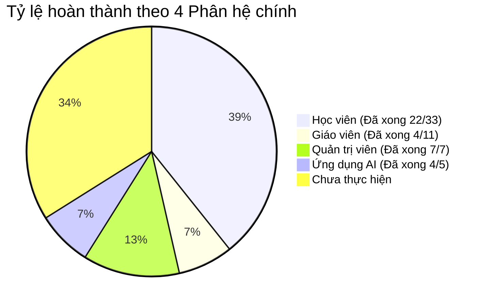

# 📌 BẢNG THEO DÕI ROADMAP TOÀN DIỆN DỰ ÁN NIKALEARN

> **Dự án:** Nền tảng Luyện thi TOEIC & E-learning Thông minh NikaLearn  
> **Sinh viên thực hiện:** Trần Phú Quốc (26DTHA6) — **Đại học:** HUTECH  
> **Ngày cập nhật:** 09/11/2026 (Phiên làm việc: Lưu kết quả thi cô lập theo User ID, Detailed Answer Review chuẩn Study4 & Tối ưu hóa Toàn diện Quản lý Đề thi ETS)  
> **Cấu trúc phân loại:** Theo 4 Phân hệ chính: **Học viên** | **Giáo viên** | **Quản trị viên (Admin)** | **Ứng dụng AI**  

---

## 📊 TỔNG QUAN TIẾN ĐỘ THEO 4 NHÓM ĐỐI TƯỢNG

| Phân hệ | Tổng số chức năng | 🟢 Hoàn thành | 🟡 Đang làm | ⚪ Chưa làm | Tiến độ |
| :--- | :---: | :---: | :---: | :---: | :---: |
| **🎓 1. PHÂN HỆ HỌC VIÊN (Student)** | 33 | 22 | 2 | 9 | **73%** |
| **👨‍🏫 2. PHÂN HỆ GIÁO VIÊN (Teacher / TA)** | 11 | 4 | 2 | 5 | **45%** |
| **⚙️ 3. PHÂN HỆ QUẢN TRỊ VIÊN (Admin)** | 7 | 7 | 0 | 0 | **100%** |
| **🤖 4. PHÂN HỆ ỨNG DỤNG AI (AI Engine)** | 5 | 4 | 0 | 1 | **80%** |
| **🔥 TỔNG TOÀN DỰ ÁN** | **56** | **37** | **4** | **15** | **~75%** |

---

## 🌟 ĐIỂM NHẤN CÔNG NGHỆ & ĐỘT PHÁ MỚI HOÀN THÀNH (09/11/2026)

### 🎯 1. Lưu & Cô Lập Kết Quả Thi Tuyệt Đối Theo Tài Khoản (`user_id` trên Supabase)
- **Cô lập LocalStorage**: Gắn định danh tài khoản vào cache key (`toeic_attempt_${user.id}_${testId}`), loại bỏ hoàn toàn nguy cơ tài khoản A bị dính kết quả của tài khoản B khi đăng xuất/đăng nhập.
- **Lưu trực tiếp vào Supabase `test_attempts`**: Khi nộp bài, tự động ghi lại `user_id`, `test_id`, `user_answers` (JSON Object), `selected_parts`, `correct_count`, `wrong_count`, `skipped_count`, `time_taken_seconds`.
- **Trạng thái bài thi động theo tài khoản**: Danh sách đề thi `/exam` tự động hiển thị biểu tượng tích xanh và nút "Xem kết quả" dựa trên chính lịch sử thi của tài khoản đang đăng nhập; tài khoản chưa làm chỉ hiện nút "Chi tiết".

### 🔍 2. Chế Độ Xem Chi Tiết Đáp Án Chuẩn 100% Study4 (Detailed Answer Review)
- **Điều hướng mượt mà (Smooth Navigation)**: Nút "Xem chi tiết đáp án" và chữ "[Chi tiết]" ở từng câu (1 → 200) tự động chuyển sang Part tương ứng và cuộn mượt (`scrollIntoView`) tới chính xác câu hỏi đó.
- **Hiển thị Transcript & Lời giải chuẩn Study4**:
  - Nút dropdown `Hiện Transcript ▾` / `Ẩn Transcript ▴` có viền bo góc sắc nét.
  - Tự động ngắt đoạn xuống dòng cách điệu giữa từng phương án `(A)`, `(B)`, `(C)`, `(D)` qua hàm `formatTranscript()`.
  - Nút link `Giải thích chi tiết đáp án ▾` / `Thu gọn giải thích ▴` hiển thị lời dịch tiếng Việt và phân tích ngữ pháp.
- **Question Palette 200 câu**: Chia theo 7 Part, tô màu trực quan: Xanh lá (Đúng), Đỏ (Sai), Xám/Trắng (Bỏ qua), bấm để nhảy câu tức thì.
- **Trạng thái kết quả rõ ràng**: Highlight xanh lá cho câu làm đúng, gạch đỏ và báo lỗi `✕ Lời giải chưa chính xác (Bạn chọn: X)` kèm `✓ Đáp án đúng: Y`.

### 🛠️ 3. Tối Ưu Phòng Làm Bài & Quản Lý Đề Thi Admin
- **Chuẩn hóa phương án trong Phòng thi (`/exam/[id]/practice`)**: Đọc chính xác JSONB Object `options`, cắt bỏ tiền tố lặp `"A. "`, `"B. "`, tự động ẩn đáp án D cho Part 2 (chỉ 3 đáp án A-B-C), xóa bỏ chuỗi fallback `"Phương án "`.
- **Tối ưu Import & Bulk Insert Đề thi (`/admin/exams/new`)**:
  - Khắc phục triệt để lỗi UUID (`code: 22P02`) và lỗi khóa ngoại foreign key constraint `questions_test_id_fkey`.
  - Bảo toàn 100% dữ liệu `audio_url`, `image_url`, `transcript`, `part_number`, `question_number`, `options` khi bấm "Hoàn tất & Lưu đề thi".
  - Trang quản trị chi tiết đề thi `/admin/exams/[id]` tích hợp đầy đủ Audio Player, Ảnh mô tả Picture và khối Transcript.

---

# 🎓 PHẦN 1: CHỨC NĂNG DÀNH CHO HỌC VIÊN (STUDENT)

---

### 1.1. Module Tài khoản & Bảo mật (16 tính năng)
| STT | Chức năng | Trạng thái | Tiến độ | Vị trí mã nguồn / Ghi chú |
| :---: | :--- | :---: | :---: | :--- |
| **01** | **Đăng ký tài khoản (Email / Số điện thoại)** | 🟢 Hoàn thành | 100% | Đã gộp 1 ô nhập duy nhất, tự nhận diện Email hoặc SĐT; cấp 16 mã Recovery Keys (`/api/auth/register`, `AuthModal.tsx`). |
| **02** | **Đăng ký / Đăng nhập Google OAuth2** | 🟢 Hoàn thành | 100% | Google OAuth tích hợp Supabase Auth (Đã bỏ Facebook theo yêu cầu). |
| **03** | **Xác thực tài khoản (OTP Email / SMS)** | 🟢 Hoàn thành | 100% | Gửi OTP 6 số qua Gmail SMTP hoặc SMS; có hỗ trợ hiển thị mã dev trên popup (`/api/auth/verify-account`, `AuthModal.tsx`). |
| **04** | **Đăng nhập hệ thống** | 🟢 Hoàn thành | 100% | Hỗ trợ Email / SĐT / Username + Mật khẩu, Remember Me 30 ngày, cookie HttpOnly JWT (`/api/auth/login`). |
| **05** | **Đăng xuất hệ thống** | 🟢 Hoàn thành | 100% | Xóa cookie `auth_token`, dọn sạch AuthContext (`/api/auth/logout`). |
| **06** | **Quên mật khẩu & Reset mật khẩu** | 🟢 Hoàn thành | 100% | Đặt lại mật khẩu bằng mã OTP Email/SMS hoặc 16 mã Recovery Keys, đóng modal tự động reset state (`ForgotPasswordModal.tsx`). |
| **07** | **Đổi mật khẩu (Buộc đăng nhập)** | 🟢 Hoàn thành | 100% | Xác thực bcrypt mật khẩu cũ trước khi lưu mật khẩu mới (`/api/users/password`, `/settings`). |
| **08** | **Cập nhật hồ sơ cá nhân** | 🟢 Hoàn thành | 100% | Cập nhật Họ tên, Trường ĐH (`student_university`), Chuyên ngành (`student_major`) tại `/settings`. |
| **09** | **Cập nhật hình ảnh đại diện (Avatar)** | 🟢 Hoàn thành | 100% | Tải ảnh lên Cloudinary CDN qua `/api/upload/avatar`, hiển thị tức thì trên Header & Menu. |
| **10** | **Thiết lập mục tiêu điểm & Deadline** | 🟢 Hoàn thành | 100% | Chọn mốc điểm TOEIC (500/650/785/900+) và ngày thi dự kiến tại `/settings`. |
| **11** | **Giao diện chuẩn Responsive Mobile** | 🟢 Hoàn thành | 100% | Đã tối ưu Sidebar desktop cố định, thanh điều hướng đáy (Bottom Nav Bar) và khay kéo drawer mobile. |
| **12** | **Xem lịch sử thi & điểm thi theo User** | 🟢 Hoàn thành | 100% | Lưu và truy vấn lịch sử thi cô lập theo `user_id` trên Supabase `test_attempts`, hiển thị trạng thái tích xanh chính xác. |
| **13** | **Quản lý đa thiết bị (User Sessions)** | ⚪ Chưa làm | 0% | Bảng `user_sessions` theo dõi IP, Thiết bị, Trình duyệt; nút đăng xuất từ xa tại `/settings`. |
| **14** | **Bảo mật 2FA (Authenticator & Email)** | ⚪ Chưa làm | 10% | Quét mã QR TOTP cho Google Authenticator / Microsoft Authenticator hoặc mã gửi qua Email. |
| **15** | **Audit Log (Nhật ký hành động)** | ⚪ Chưa làm | 0% | Bảng `audit_logs` tự động ghi nhận thời gian, IP và hành vi nhạy cảm của người dùng. |
| **16** | **Gửi thông báo (Điểm thi & Nhắc học)** | 🟡 Một phần | 30% | Đã có cấu hình notification preferences trong settings; thông báo toast tức thì. |

---

### 1.2. Module Học và luyện tập TOEIC
- [x] **Kho Đề thi TOEIC chuẩn ETS (`/exam`):**
  - [x] Tải danh sách đề thi đã xuất bản từ Supabase với bộ nhớ đệm React Query (0ms delay).
  - [x] Bộ lọc tìm kiếm đề thi chuyên biệt, thanh tìm kiếm đề thi gọn gàng, trạng thái hoàn thành tích xanh theo từng tài khoản.
- [x] **Chi tiết Đề thi & Chọn Part (`/exam/[id]`):**
  - [x] Chọn linh hoạt từ Part 1 đến Part 7 hoặc làm Full Test 200 câu.
  - [x] Chọn thời gian làm bài (15, 30, 45, 60, 90, 120 phút hoặc không giới hạn).
  - [x] Danh sách tag dạng bài theo từng Part (Tranh tả người, Câu hỏi WH, Hội thoại, Ngữ pháp, Đoạn văn...).
- [x] **Phòng Luyện thi Thực chiến (`/exam/[id]/practice`):**
  - [x] Trình phát Audio nghe tích hợp ảnh câu hỏi Part 1, 2, 3, 4.
  - [x] Chuẩn hóa phương án A, B, C, D từ JSONB, cắt tiền tố lặp, ẩn đáp án D cho Part 2.
  - [x] Đồng hồ đếm ngược tự động nộp bài khi hết giờ.
  - [x] Bảng nhảy nhanh đến câu hỏi (Question Palette).
- [ ] **Flashcard tương tác & Spaced Repetition (SRS):**
  - [x] Thẻ lật 2 mặt xem phiên âm IPA, nghĩa tiếng Việt, ví dụ câu ngữ cảnh và audio mẫu.
  - [ ] Thuật toán Spaced Repetition (SRS) tự động nhắc ôn tập từ vựng hay sai.
- [ ] **Luyện phát âm & Nói (Speaking & Pronunciation):**
  - [x] Ghi âm và chấm điểm phát âm tại `/ai-tutor` (Tab Pronunciation).
  - [ ] Luyện Shadowing các đoạn thoại Part 3 & Part 4, đối chiếu waveform giọng đọc.

---

### 1.3. Module Thi thử TOEIC Full Test & Review Kết quả
- [x] **Đề thi chuẩn ETS:** Hỗ trợ Full 200 câu trong 120 phút liên tục (Listening + Reading).
- [ ] **Chế độ Proctor nhẹ (Kế hoạch phiên làm việc tới):** 
  - [ ] Toàn màn hình (Full-screen mode).
  - [ ] Phát hiện và phát cảnh báo khi thí sinh rời tab / chuyển màn hình.
  - [ ] Chế độ không transcript trong lúc thi để đảm bảo tính trung thực.
- [x] **Chấm điểm tức thì:** Ước lượng thang điểm Listening (5 - 495), Reading (5 - 495) và Tổng điểm (10 - 990).
- [x] **Trang Xem chi tiết đáp án chuẩn Study4 (`/exam/[id]/result`):**
  - [x] Phân chia 2 cột: Cột trái nội dung câu hỏi kèm Audio, Ảnh, Transcript, Lời giải; Cột phải Question Palette 200 câu.
  - [x] Bấm nút "[Chi tiết]" ở từng câu tự động nhảy đúng Part và cuộn mượt (`scrollIntoView`) tới đúng câu.
  - [x] Nút toggle "Hiện Transcript ▾" ngắt dòng đẹp mắt và toggle "Giải thích chi tiết đáp án ▾" chuẩn Study4.
  - [x] Highlight phương án đúng/sai/bỏ qua rõ ràng.

---

# 👨‍🏫 PHẦN 2: CHỨC NĂNG DÀNH CHO GIÁO VIÊN / TRỢ GIẢNG

---

### 2.1. Module Soạn & Quản lý đề thi (Exam Authoring)
- [x] **Soạn thảo đề Part 1 - 7:** Tạo đề thi mới, phân loại câu hỏi theo từng Part TOEIC.
- [x] **Import nhanh từ JSON & Nạp từ Data:** Nạp tự động 200 câu hỏi cả 7 Part từ file JSON với đầy đủ âm thanh, hình ảnh, transcript.
- [x] **Bulk Insert tối ưu:** Lưu hàng loạt 200 câu hỏi và 800 đáp án vào database chỉ trong 1 request, không bị lỗi UUID hay khóa ngoại.
- [x] **Tự động lưu nháp (Draft Auto-sync):** Tự động lưu tiến trình soạn đề vào `localStorage` (`toeic_exam_creator_draft`) chống mất dữ liệu khi mất mạng hoặc F5.
- [x] **Upload tư liệu đa phương tiện:** Upload file Audio nghe, ảnh minh họa câu hỏi.

---

# ⚙️ PHẦN 3: CHỨC NĂNG QUẢN TRỊ VIÊN (ADMIN)

---

### 3.1. Quản lý người dùng & Bảo mật (`/admin/users`)
- [x] **Xem danh sách tài khoản:** Tra cứu người dùng theo email, tên đăng nhập, trạng thái kích hoạt.
- [x] **Phân quyền vai trò (Role-Based Access):** Phân chia 3 quyền: Học viên (`student`), Giảng viên (`teacher`), Quản trị (`admin`).
- [x] **Edge Middleware Bảo mật đường truyền:** Kiểm tra nghiêm ngặt session và role, chặn đứng mọi truy cập trái phép vào `/admin` và `/api/admin` với trang 403 Forbidden chuẩn chỉnh.

### 3.2. Quản lý ngân hàng đề thi (`/admin/exams`)
- [x] **Danh sách đề thi:** Quản lý kho đề thi TOEIC L&R, hiển thị số câu hỏi, thời gian làm bài.
- [x] **Xem chi tiết & Quản lý câu hỏi (`/admin/exams/[id]`):** Hiển thị đầy đủ Badge Part, Audio Player MP3, Ảnh mô tả Picture, Transcript và Lời giải chi tiết của từng câu hỏi.
- [x] **Duyệt & Xuất bản đề:** Chuyển trạng thái Nháp (Draft) sang Xuất bản (Published) để hiển thị đồng bộ tức thì ra trang `/exam` của học viên.

### 3.3. Báo cáo & Dashboard quản trị (`/admin`)
- [x] **Mục tiêu sinh viên & Thống kê động:** Tự động tính toán tổng số lượt làm bài, số sinh viên đạt mục tiêu mốc 500+, 650+, 785+, 900+ dựa trên dữ liệu thi thật trong cơ sở dữ liệu.
- [x] **Giao diện Admin SPA mượt mà:** Khung sidebar cố định, chuyển đổi giữa các module quản trị tức thì không giật lag.

---

# 🤖 PHẦN 4: ỨNG DỤNG AI ĐỘT PHÁ (AI ECOSYSTEM)

---

### 4.1. Hệ thống AI Gateway & Gia sư AI TOEIC
- [x] **Model Gemini Tốc độ cao:** Tích hợp `gemini-3.1-flash-lite` phản hồi nhanh ~1.5s, cơ chế xoay vòng model & API key chống nghẽn tải.
- [x] **Chatbot Gia sư AI TOEIC (`/ai-tutor`):** Hỏi đáp ngữ pháp, từ vựng, giải thích chiến lược làm bài thi Part 1 - 7.
- [x] **Bền vững cuộc trò chuyện (Persistent Chat State):** Nhờ `AiTutorContext`, học viên rời tab đi làm đề thi rồi quay lại, toàn bộ lịch sử chat vẫn nguyên vẹn.
- [x] **Luyện phát âm & Chấm điểm IPA (`/ai-tutor`):** Ghi âm giọng đọc câu mẫu TOEIC Listening và phân tích phát âm theo chuẩn.

---

## 📌 LƯU Ý & KẾ HOẠCH CHO PHIÊN LÀM VIỆC TIẾP THEO

> [!IMPORTANT]
> **Nhiệm vụ trọng tâm phiên tới:**
> 1. **Chế độ Proctor nhẹ khi thi thử:**
>    - Bật toàn màn hình (Full-screen mode) khi bắt đầu làm bài.
>    - Phát hiện và đưa ra cảnh báo khi thí sinh rời tab / chuyển cửa sổ.
>    - Khóa tính năng xem transcript trong lúc làm bài để bảo đảm tính nghiêm túc của bài thi.
> 2. **Thuật toán Spaced Repetition (SRS) cho Từ vựng & Flashcards.**

---
*Roadmap đã được cập nhật thành công vào lúc 16:45 ngày 09/11/2026. Chúc bạn có thời gian nghỉ ngơi thật thoải mái!* ☕🌿
